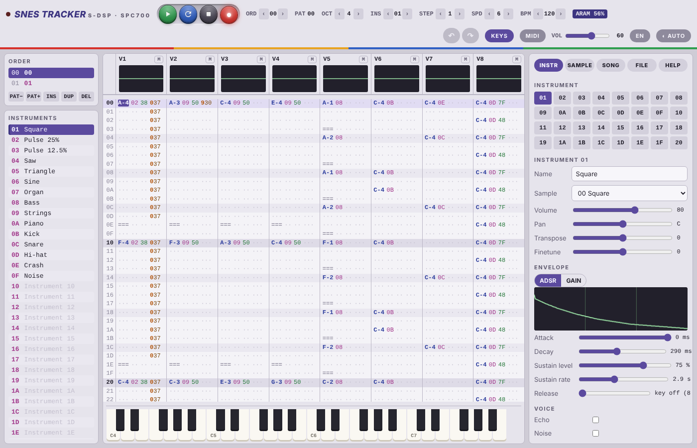
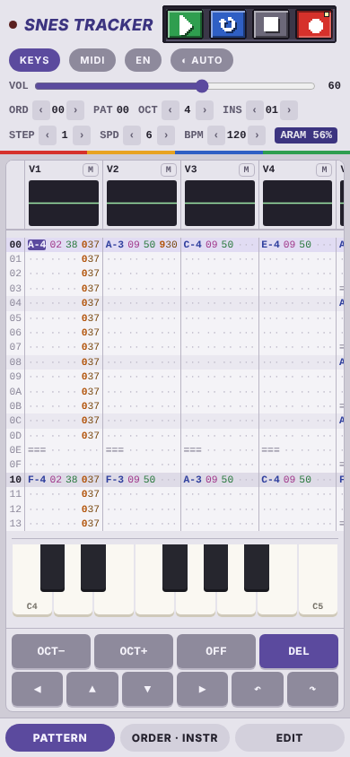
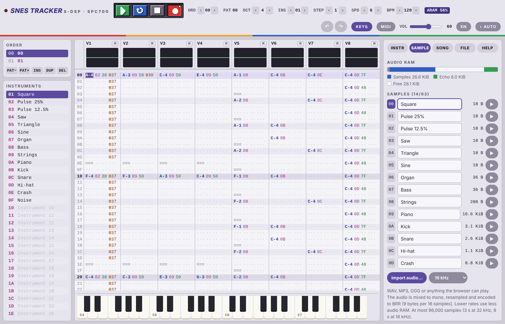

# SNES Tracker manual

SNES Tracker is a music tracker for the sound hardware of the Super Nintendo
(SNES / Super Famicom): the SPC700 sound CPU with its S-DSP, eight voices of
BRR samples at 32 kHz, ADSR and GAIN envelopes, and the hardware echo. It runs
in the browser, on the desktop and on the phone, needs no installation and
keeps your songs in the browser.

## Contents

- [Quick start](#quick-start)
- [The screen](#the-screen)
- [The sound hardware](#the-sound-hardware)
- [Patterns and the pattern editor](#patterns-and-the-pattern-editor)
- [Entering notes and values](#entering-notes-and-values)
- [Keyboard shortcuts](#keyboard-shortcuts)
- [Touch and phone use](#touch-and-phone-use)
- [On-screen piano and MIDI keyboards](#on-screen-piano-and-midi-keyboards)
- [Song structure: order list and patterns](#song-structure-order-list-and-patterns)
- [Instruments](#instruments)
- [Samples](#samples)
- [Making samples](#making-samples)
- [Echo](#echo)
- [Effects](#effects)
- [Speed and tempo](#speed-and-tempo)
- [Audio RAM](#audio-ram)
- [Saving and loading](#saving-and-loading)
- [Exporting](#exporting)
- [Tips and hardware quirks](#tips-and-hardware-quirks)
- [Privacy](#privacy)

## Quick start

1. Open the tracker. It starts with a demo song; press ▶ (or the space bar) to
   hear it.
2. Click a cell in the pattern and type notes with the keyboard: `Z S X D C`
   are C, C#, D, D#, E in the lower row, `Q 2 W 3 E` an octave above. `1`
   writes a note off (`===`).
3. Pick the instrument with the `INS` stepper in the toolbar, or by clicking a
   name in the instrument list.
4. `OCT` sets the octave, `STEP` how far the cursor moves after each note.
5. Open the FILE tab and press **Save** to keep the song in the browser, or
   one of the export buttons to take it with you.



## The screen

- **Toolbar**: transport (play, loop the pattern, stop, record mode), the
  steppers for order position, pattern, octave, instrument, step, speed and
  tempo, the audio RAM badge, undo and redo, the piano and MIDI switches, the
  master volume, the language and the theme.
- **Left column**: the order list and the instruments.
- **Middle**: the eight voice headers with their scopes and mute buttons, and
  the pattern.
- **Right column**: the tabs INSTR (instrument), SAMPLE, SONG, FILE and HELP.
- **Bottom**: the on-screen piano, and on phones the keypad and the view
  switcher.

The master volume and the mute buttons only change what you hear. Exports
always use the song as it is written.

## The sound hardware

The S-DSP has **eight voices**. Every voice can play any instrument, so unlike
the Game Boy there are no fixed channel types. Each voice plays a **BRR
sample**: compressed audio in blocks of 9 bytes that hold 16 samples. The DSP
mixes at **32 kHz** and interpolates with a Gaussian filter, which gives the
console its soft, slightly dark sound.

Every voice has

- a volume for the left and the right output (the tracker writes them from the
  instrument volume and the pan),
- a pitch register, where `0x1000` plays the sample at its own rate,
- an **ADSR** or **GAIN** envelope,
- switches for the echo, the noise generator, pitch modulation from the
  previous voice, and surround (inverted right channel).

Samples, the sample directory and the echo buffer share **64 KiB of audio RAM**
(ARAM). The SAMPLE tab shows how much is in use.

## Patterns and the pattern editor

A pattern is a table of rows: one row per step, one column group per voice.
Patterns hold 1 to 256 rows and are 64 rows long by default. A cell has five
parts:

| Field | Width | Meaning |
| --- | --- | --- |
| note | 3 | `C-4`, `A#3`, `===` for note off, `···` for empty |
| instrument | 2 | `01`–`20` (hex), the instrument that plays the note |
| volume | 2 | `00`–`7F`, overrides the instrument volume for this note |
| effect | 1 | `0`–`F`, see [Effects](#effects) |
| parameter | 2 | `00`–`FF`, the effect's value |

A note without an instrument keeps the one the voice played before.

## Entering notes and values

### Record mode

The red ● button (or `Esc`) switches record mode. With it **off** the keys and
the piano only play; with it **on** they also write into the pattern. The
setting is remembered.

### Entering values

Put the cursor on a field and type: notes in the note field, hex digits in the
instrument, volume, effect and parameter fields. The cursor then moves down by
`STEP` rows (note and the last digit of a group only). `Del` clears the field
under the cursor, or the whole selected block.

### Note keys

The note keys follow the physical key positions, so they work on QWERTZ,
AZERTY and Dvorak the same way:

```
lower octave:   Z S X D C V G B H N J M
upper octave:   Q 2 W 3 E R 5 T 6 Y 7 U
```

`1` writes a note off. `[` and `]` (and the numpad `−` and `+`) change the
octave, which runs from 0 to 7; `C-4` is the middle C and plays a sample at
its own rate.

## Keyboard shortcuts

| Keys | What they do |
| --- | --- |
| Arrows | Move the cursor |
| Tab / Shift+Tab | Next / previous voice |
| Space | Play or stop the song |
| Shift+Space | Loop the pattern from the cursor |
| Esc | Record mode on or off |
| `[` `]` | Octave down / up |
| Del / ⌫ | Clear the field or the block |
| Ins | Insert a row |
| Ctrl+Z / Ctrl+Y | Undo / redo |
| Shift+arrows | Select a block |
| Ctrl+A | Select the pattern, Ctrl+Shift+A the voice |
| Ctrl+C / Ctrl+X | Copy / cut |
| Ctrl+V | Paste (with Shift: only filled cells) |
| Ctrl+↑ / Ctrl+↓ | Transpose the block by a semitone (with Shift: an octave) |
| Ctrl+S | Save to the library |

Blocks can also be selected by dragging with the mouse.

## Touch and phone use

On a phone the three views are switched with the bar at the bottom: PATTERN
shows the pattern, ORDER · INSTR the order list and the instruments, and EDIT
the tabs. A keypad appears under the pattern: arrows move the cursor,
`OFF` writes a note off, `DEL` clears, and with the piano hidden the keypad
has note keys instead. Undo and redo are on the keypad too.



## On-screen piano and MIDI keyboards

**KEYS** shows or hides the piano. Clicking or tapping a key plays the current
instrument; with record mode on and the cursor in a note field it also writes
the note. Sliding across the keys only plays them.

**MIDI** connects MIDI keyboards (Chrome, Edge and Firefox; Safari has no Web
MIDI). MIDI note 60 is `C-4`. Velocity is written into the volume column.

## Song structure: order list and patterns

The order list says in which order the patterns play. `PAT−` and `PAT+` change
the pattern of the selected position, `INS` inserts a position with the same
pattern, `DUP` inserts a copy of the pattern, and `DEL` removes the position.
A song can hold up to 256 patterns.

Effect `Bxx` jumps to order position `xx`, `Dxx` breaks out of the pattern and
continues at row `xx` of the next one.

## Instruments

An instrument is a sample plus how it is played. The INSTR tab has 32 of them.

- **Sample**: which sample the instrument plays.
- **Volume** (`00`–`7F`) and **Pan** (`00` left, `80` centre, `FF` right).
- **Transpose** in semitones and **Finetune** in 1/128 semitone.
- **Envelope**: ADSR or GAIN.
  - **ADSR**: *attack* (0–15, 0 is instant, 15 is 4.1 s), *decay* (0–7) down to
    the *sustain level* (1/8 to 8/8), then the *sustain rate* (0–31) fades the
    note while the key is held; rate 0 holds it forever.
  - **GAIN**: a fixed level, or a linear, exponential or bent ramp up or down.
- **Release**: with 0 a note off uses the hardware key off, which fades out in
  about 8 ms; from 1 up the tracker fades with a GAIN ramp instead, which is
  gentler.
- **Voice**: *Echo* feeds this voice into the echo, *Noise* plays the DSP noise
  generator instead of the sample, *Pitch modulation* lets the previous voice
  modulate this one's pitch (not available on voice 1).

The graph shows the envelope as the DSP really produces it, measured on the
emulation, including what happens after the key is released.

## Samples

The SAMPLE tab holds up to 63 samples, the number the hardware's sample
directory has room for.



- **Import audio…** takes WAV, MP3, OGG, FLAC — anything the browser can
  decode. The audio is mixed to mono, resampled to the chosen rate and encoded
  to BRR. The rate select is the biggest lever you have on memory: 32 kHz
  sounds best, 16 kHz uses half the space and is what most SNES games used for
  anything but drums and leads. An **SPC** file adds the samples found in its
  sample directory (see [SPC files](#spc-files)).
- **Loop**: BRR loops at a block boundary. Switch the loop on and set the start
  with the slider, or click into the waveform.
- **Rate** is the frequency at which `C-4` plays the sample. **Tune** shifts it
  by semitones.
- **Normalize**, **Reverse**, **Half rate** (halves the memory and the treble),
  **Duplicate**, **WAV** (download) and **New instrument** (makes an instrument
  that plays this sample).

## Making samples

Two synths are built in, both at the bottom of the SAMPLE tab.

- **Waveform synth**: square (with a duty control), saw, triangle, sine, a
  16-slider harmonics editor, or a waveform you draw with mouse or finger. One
  cycle is written as a looping sample tuned so that `C-4` plays `C-4`. Cycles
  of 16 to 256 samples: longer is smoother in the bass, shorter saves memory
  and reaches higher.
- **Drum synth**: kick, snare, hi-hat, tom, clap and cymbal, with pitch, decay,
  noise mix and sample rate. The result is a one-shot sample.

Both can be added as a new sample or replace the selected one, and **▶ Listen**
plays them before you decide.

## Echo

The S-DSP's echo is a delay line in audio RAM with an 8-tap FIR filter.

- **Delay**: 0–15, in steps of 16 ms. Every step takes 2 KiB of audio RAM, so a
  long echo and long samples compete for the same memory.
- **Feedback** and **Volume left / right**: signed, −128 to 127.
- **FIR filter**: eight taps that filter the echoed signal. Presets are
  included (flat, low-pass, soft, high-pass). Keep the sum of the taps near 127;
  much more than that, together with feedback, can make the echo run away.

Only voices with *Echo* on feed the echo, and effects `9xx` and `Cxx` change the
echo volume and feedback while the song plays.

## Effects

| Effect | What it does |
| --- | --- |
| `0xy` | Arpeggio: the note, +x and +y semitones, one per tick |
| `1xx` | Slide up by xx/16 semitone per tick |
| `2xx` | Slide down by xx/16 semitone per tick |
| `3xx` | Portamento to the note at speed xx |
| `4xy` | Vibrato: speed x, depth y/16 semitone |
| `5xy` | Voice flag x (0 echo, 1 pitch modulation, 2 noise, 3 surround); y = 0 switches it off, anything else on |
| `6xx` | Noise clock, 00–1F (the rate of the shared noise generator) |
| `7xx` | Delay the note by xx ticks |
| `8xx` | Pan: 00 left, 80 centre, FF right |
| `9xx` | Echo volume (signed, 80–7F) |
| `Axy` | Volume slide: x up, y down, per tick |
| `Bxx` | Jump to order position xx |
| `Cxx` | Echo feedback (signed, 80–7F) |
| `Dxx` | Pattern break, continue at row xx |
| `Exx` | Cut the note after xx ticks |
| `Fxx` | Below 20: speed in ticks per row. From 20 up: tempo in BPM |

## Speed and tempo

A row lasts `speed` ticks. A tick is `2.5 s ÷ BPM` long, the same relation the
SPC700's timer 0 gives on the hardware, so at 120 BPM a tick is 20.8 ms and, at
speed 6, four rows make a beat. The SONG tab shows the resulting tick rate.

## Audio RAM

The 64 KiB of audio RAM hold, from the bottom: the driver and the sample
directory, then the samples, and at the very top the echo buffer. The badge in
the toolbar and the meter in the SAMPLE tab show how they divide up.

If the samples and the echo buffer overlap, the tracker switches the echo
*writes* off, exactly as a real driver would have to, and says so. Shorten the
echo delay, use a lower sample rate or drop a sample.

## Saving and loading

The FILE tab has the buttons **New**, **Save**, **Save as…**, **Load demo**,
**Import…**, **Download (.json)** and **Back up library (.zip)**.

- Your work is kept in the browser after every change, so reloading the page
  loses nothing.
- **Save** puts the song in the library, a list of songs kept in this browser
  (IndexedDB). Songs can be renamed, duplicated, deleted and searched, and
  **♫** takes the instruments, samples and echo settings of another song
  without touching your notes.
- **Download (.json)** writes a single song file, **Back up library (.zip)**
  writes all of them. **Import…** takes both back, and SPC files too.
- The library lives in this browser on this device. Back it up.

### Install as an app and use offline

The tracker is a progressive web app: install it from the browser's menu
("Install app", "Add to home screen") and it opens in its own window and works
without a connection.

## Exporting

| Export | What you get |
| --- | --- |
| **Export SPC** | The song with its own SPC700 driver, in the 64 KiB memory image SPC players and hardware loaders expect |
| **Export WAV** | The rendered audio, 32 kHz stereo |
| **Export MP3** | The same audio as MP3, 192 kbit/s |
| **Export MP4 video** | 1280×720 video with the eight voice scopes and the scrolling pattern |
| **Export XM** | A FastTracker 2 module, for OpenMPT, MilkyTracker and others |
| **Export stems** | One WAV per voice in a ZIP |

**Loops** says how many times the song is played before the export ends.

The **SPC** export captures the DSP register writes of a real playback and
plays them back from a small hand-written SPC700 driver, so what you hear in
the browser is what the file plays. It says how much room the song data took
and how much is left.

### SPC files

An SPC file is a snapshot of the sound chip's memory with the game's own sound
driver in it, so the notes of a song from a game cannot be turned back into
patterns. What **Import…** does with an SPC:

- An SPC exported from this tracker carries the song after the SPC data, so it
  opens again exactly as it was exported.
- From any other SPC the samples in the sample directory become a new song: one
  instrument per sample, with the envelope of a voice that was playing it and
  the echo settings, and an empty pattern. **♫** in the library moves them
  into another song, and **Import audio…** in the SAMPLE tab adds them to the
  current one. Short loops are tuned as one cycle to `C-4`; other samples play
  at 32 kHz on `C-4`, so adjust **Rate** or **Tune** by ear.

**Play SPC…** under **SPC player** plays any SPC file as it is, game rips
included: the file's memory, DSP registers and its own sound driver run on an
emulation of the SPC700 (every opcode, the three timers, the I/O ports and the
boot ROM) next to the S-DSP. **Stop SPC**, or starting the song, ends it.

The **XM** export decodes the samples to 16 bits, measures each instrument's
envelope on the emulated DSP and writes it as an XM volume envelope. What XM
has no place for — the echo, the noise generator, pitch modulation, surround —
is listed after the export.

## Tips and hardware quirks

- Gaussian interpolation rolls off the treble. Samples recorded a little bright
  sound right after it.
- BRR blocks are 16 samples long, so loop points land on a multiple of 16. A
  loop that clicks usually just needs the block before or after.
- The noise generator is shared by all voices: one noise clock (`6xx`) at a
  time.
- Pitch modulation reads the *previous* voice's output, so put the modulator
  directly to the left of the voice it modulates.
- Keep an eye on the audio RAM badge before you commit to a long echo.

## Privacy

Everything runs in the browser. Songs, samples and the library stay on your
device: they are kept in this browser's storage only, and song files are never
uploaded. The site has no accounts. The public site may count visits and which
features are used (for example play, export formats, import, theme and
language), and record anonymous usage sessions, with a privacy-friendly
analytics service. The installed app also works offline without it.
